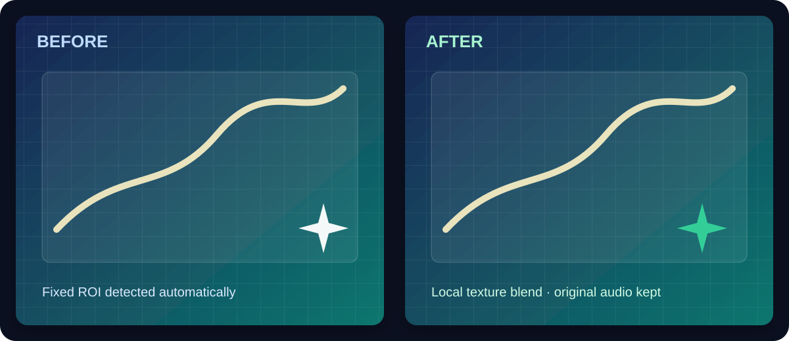

# GWR Fast Watermark Remover

[](https://github.com/toanleoht-boop/gwr-fast-watermark-remover/actions/workflows/ci.yml)
[](https://github.com/toanleoht-boop/gwr-fast-watermark-remover/releases)
[](https://github.com/toanleoht-boop/gwr-fast-watermark-remover/releases)
[](LICENSE)

A lightweight Windows desktop application for removing a **fixed, visible watermark** from images and videos you own or are authorized to edit.

The app is designed for practical batch work: select a set of files or a folder, detect or draw the logo region once, preview the repair locally, and export to a sibling folder named `Template`. Video audio is copied from the original file without re-encoding whenever the target container supports the source track.

## What it does

- Drag-and-drop images, videos, or folders.
- Process many files in one run with a single ROI.
- Automatically detect the common Gemini-style fixed sparkle watermark, with manual ROI fallback.
- Reconstruct the covered area from the best neighbouring texture and blend the boundary to reduce rectangular blur.
- Preview the first image/video frame before writing anything.
- Stop a long batch safely; the file currently being processed is not published when cancelled.
- Preserve nested folders under `Template` and skip an existing `Template` folder during recursive input scans.
- Preserve original audio in videos through the bundled FFmpeg binary, with compatible fallbacks for MP4/MOV/AVI/WebM.
- Support Unicode filenames and Windows paths.
- Save results to `Template` by default, never to the source folder itself.

> Best results require a watermark that stays in the same screen position. Moving logos, large opaque objects, and content that is permanently hidden underneath require a tracking or generative-inpainting workflow and may need manual review.

## Quick start (Windows)

1. Download the latest `GWR-Fast-Watermark-Remover-windows.zip` from [Releases](https://github.com/toanleoht-boop/gwr-fast-watermark-remover/releases).
2. Extract the ZIP and run `GWR Fast Watermark Remover.exe`.
3. Choose files/folder, click **Tự động tìm Logo**, verify the red ROI, then click **Bắt đầu xóa watermark hàng loạt**.

The output folder is created beside the selected source folder:

```text
Photos\image.jpg       -> Template\image.jpg
Videos\clip.mp4        -> Template\clip.mp4
Videos\episode-01\clip.mp4 -> Template\episode-01\clip.mp4
```

Use **Xem trước kết quả** after choosing or drawing the ROI. The preview is
computed in memory and is never saved; switch back to the original frame before
adjusting the ROI or start the batch directly.

## Preview



This preview is synthetic so the repository does not publish anyone's private media. Use permission-cleared media when recording a real workflow GIF for a release.

## Run from source

```powershell
git clone https://github.com/toanleoht-boop/gwr-fast-watermark-remover.git
cd gwr-fast-watermark-remover
py -3.11 -m venv .venv
.venv\Scripts\python -m pip install -r requirements.txt
.venv\Scripts\python main.py
```

For development and tests:

```powershell
.venv\Scripts\python -m pip install -r requirements-dev.txt
.venv\Scripts\python -m pytest -q
.venv\Scripts\python -m ruff check main.py worker.py tests
```

## Build the portable Windows release

```powershell
.venv\Scripts\python -m pip install pyinstaller
.venv\Scripts\pyinstaller --noconfirm GWR-Desktop.spec
```

The output is `dist/GWR-Fast-Watermark-Remover/`. To create the release ZIP:

```powershell
Compress-Archive -Path 'dist/GWR-Fast-Watermark-Remover/*' `
  -DestinationPath 'dist/GWR-Fast-Watermark-Remover-windows.zip' -Force
```

## Project layout

```text
main.py                 PyQt6 desktop UI and ROI/detection workflow
worker.py               Batch media worker and fast reconstruction engine
GWR-Desktop.spec        Reproducible PyInstaller configuration
tests/                  Unit tests for the reconstruction engine
docs/                   Architecture and contribution notes
.github/workflows/      Continuous integration
RELEASING.md            Maintainer release checklist
THIRD_PARTY_NOTICES.md  Dependency licensing notes
```

## Quality and limitations

The fast engine assumes one logo position for the whole batch. It is a local
texture/Poisson repair, so it works best for small translucent marks over
repeated or smooth backgrounds. A logo that moves, changes size, or covers a
face/object needs a tracked ROI or a generative inpainting workflow and should
be reviewed frame-by-frame. The app never claims to recover pixels that were
permanently hidden by an opaque mark.

For video, frames are decoded and re-encoded because the watermark is removed
from every frame. The original audio stream is then muxed back in. WebM output
uses a compatible VP9/Opus encode and can therefore take longer than MP4/MOV.

### Troubleshooting

- If automatic detection cannot find a logo, drag a rectangle around it in the
  preview and run again.
- If an output already exists, running the batch again replaces that file with
  a complete new file; temporary `.gwr-partial` files are cleaned up.
- If a video has no audio, the video is still exported normally.
- Very large 4K batches need free disk space for temporary frame files and the
  final `Template` folder.

## Privacy and responsible use

Processing is local. The application does not upload media or call a cloud AI service. Only remove marks from media you own or have permission to modify; do not use it to misrepresent authorship or evade rights-management notices.

## Contributing

Bug reports and pull requests are welcome. Please read [CONTRIBUTING.md](CONTRIBUTING.md), include a reproducible example without private media, and run the test suite before opening a pull request.

## License

Released under the [MIT License](LICENSE). FFmpeg and Python dependencies retain their own licenses.
